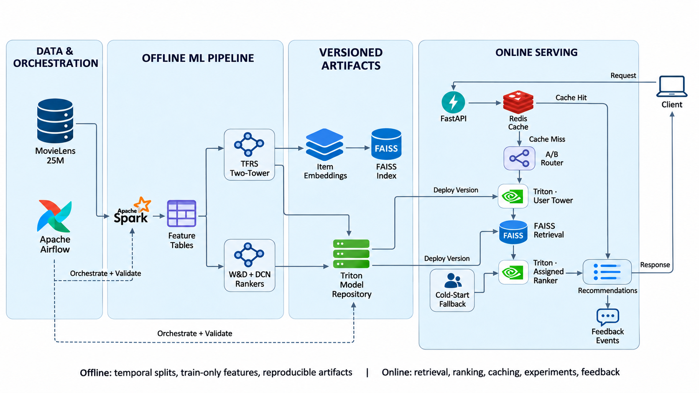

# Large-Scale Personalized Recommendation Engine

[](https://github.com/AmeriMajd/large-scale-recommender/actions/workflows/ci.yml)
[](https://github.com/AmeriMajd/large-scale-recommender/actions/workflows/integration.yml)
[](https://www.python.org/downloads/)
[](LICENSE)

A production-style, two-stage movie recommendation system built with MovieLens
25M. A TensorFlow Recommenders two-tower model retrieves a few hundred
candidates, then a deep ranking model re-scores them to produce the final
recommendations.

**[Try the live portfolio demo](https://large-scale-recommender.pages.dev)** ·
**[Read the model card](docs/MODEL_CARD.md)** ·
**[View the API contract](docs/API_CONTRACT.md)**



This repository is an internship project for the AI / Machine Learning
specialization track. The goal is not only to train a model, but to demonstrate
the complete lifecycle: data processing, training, evaluation, approximate
nearest-neighbor retrieval, serving, caching, orchestration, and experimentation.

## Current status

Days 1–10 are implemented: the repository includes the reproducible temporal
and feature pipelines, two-tower retrieval, persistent exact/HNSW FAISS
indexes, two exported deep rankers, cold-start fallbacks, versioned Redis
caching, a tested recommendation/feedback API, Triton model-repository and
client integration, a responsive recommendation demo, and a ten-stage Airflow
retraining DAG. Redis and the Airflow DAG have been tested live in their pinned
containers. The large Triton container run remains pending and is not presented
as completed evidence.

### Current baseline

| Metric | Result |
|---|---:|
| Training interactions | 19,986,521 |
| Validation interactions | 2,501,547 |
| Test interactions | 2,512,027 |
| Evaluated test users | 18,344 |
| Popularity Recall@10 | 0.0455 |
| Popularity NDCG@10 | 0.2408 |
| Popularity Recall@20 | 0.0732 |
| Popularity NDCG@20 | 0.2127 |

See [docs/DAY_01_REPORT.md](docs/DAY_01_REPORT.md) for definitions,
interpretation, and lessons learned.

### Current feature snapshot

| Table or audit value | Result |
|---|---:|
| Feature cutoff | 22 June 2016 UTC |
| Training users | 137,823 |
| Catalog items | 62,423 |
| Items seen in training | 34,444 |
| User–genre rows | 2,255,079 |
| Validation unseen users | 12,720 |
| Test unseen users | 14,407 |
| Total feature storage | 112 MiB |

See [docs/FEATURE_CONTRACT.md](docs/FEATURE_CONTRACT.md) for table semantics and
[docs/DAY_02_REPORT.md](docs/DAY_02_REPORT.md) for the code walkthrough,
debugging log, tests, exercises, and learning resources.

### Current retrieval experiment

| Metric | Two tower | Matched popularity |
|---|---:|---:|
| Recall@10 | 0.0097 | 0.0210 |
| Recall@50 | 0.0429 | 0.0772 |
| Recall@100 | 0.0770 | 0.1242 |
| Recall@200 | 0.1349 | 0.1870 |
| NDCG@200 | 0.0590 | 0.1028 |

The ID-only development model does not beat popularity. That result is reported
rather than hidden. The exported `(24,728, 64)` item matrix drives the FAISS
experiment below; adding history, genre, and popularity features to the towers
is a future improvement.

See [docs/RETRIEVAL_CONTRACT.md](docs/RETRIEVAL_CONTRACT.md) for model and
evaluation semantics and [docs/DAY_03_REPORT.md](docs/DAY_03_REPORT.md) for the
full results, code walkthrough, debugging log, and study sequence.

### Current FAISS retrieval experiment

| Index / setting | Recall@200 vs exact | P50 ms | P95 ms | Queries/s |
|---|---:|---:|---:|---:|
| Exact Flat | 1.0000 | 0.2932 | 0.3196 | 3,622 |
| HNSW `efSearch=128` | 0.9402 | 0.1824 | 0.2230 | 5,868 |
| HNSW `efSearch=256` | 0.9859 | 0.2839 | 0.3307 | 3,680 |

The benchmark uses 500 seeded user-tower queries, 24,728 candidates, K=200,
and one CPU thread. High-recall HNSW is roughly tied with exact search at this
small catalog size; the lower-depth setting exposes the expected speed/quality
trade-off. See [docs/INDEX_CONTRACT.md](docs/INDEX_CONTRACT.md) for artifact and
search semantics and [docs/DAY_04_REPORT.md](docs/DAY_04_REPORT.md) for the full
benchmark, code walkthrough, debugging log, and learning resources.

### Current ranking experiment

| Candidate order | Recall@10 | NDCG@10 | Recall@50 | NDCG@50 |
|---|---:|---:|---:|---:|
| Raw retrieval | 0.0097 | 0.0178 | 0.0429 | 0.0286 |
| Popularity | 0.0289 | 0.0713 | 0.0837 | 0.0697 |
| Wide & Deep | 0.0303 | 0.0740 | 0.0884 | 0.0744 |
| DCN | **0.0324** | **0.0753** | **0.0888** | **0.0748** |

DCN is selected by future-validation NDCG@10 after early stopping restores its
best validation-AUC epoch. The comparison uses 500 users and the same 200
retrieved candidates per user. See [docs/RANKING_CONTRACT.md](docs/RANKING_CONTRACT.md)
for labels, features, export, and evaluation semantics and
[docs/DAY_05_REPORT.md](docs/DAY_05_REPORT.md) for the full results, debugging
log, code walkthrough, exercises, and study resources.

### Current serving experiment

| Local API path | First miss | Warm P50 | Warm P95 |
|---|---:|---:|---:|
| Known user: tower + FAISS + DCN | 374.10 ms | 13.79 ms | 15.62 ms |
| Genre cold start | 119.94 ms | 14.41 ms | 16.41 ms |

The benchmark uses the real artifacts through FastAPI's in-process client and
30 warm calls on one development CPU. Redis was unavailable, so warm latency
uses the deterministic in-memory TTL backend and is not presented as production
load. See [docs/COLD_START_CACHE_CONTRACT.md](docs/COLD_START_CACHE_CONTRACT.md),
[docs/API_CONTRACT.md](docs/API_CONTRACT.md),
[docs/DAY_06_REPORT.md](docs/DAY_06_REPORT.md), and
[docs/DAY_07_REPORT.md](docs/DAY_07_REPORT.md).

## Quick start

The default `configs/dev.toml` profile reproduces the bounded development
experiments. It still processes the complete MovieLens 25M input, so allow at
least 8 GB RAM, 20 GB of free disk space, and several hours for the end-to-end
CPU workflow. The uncapped `configs/full.toml` profile is substantially more
expensive and is intended for a machine with at least 16 GB RAM.

For a fast repository check without downloading data or training models:

```bash
make setup
make check-fast
```

For the end-to-end development experiment, run these commands from the
repository root:

```bash
make setup
source .venv/bin/activate
make install-retrieval
make install-indexing
make install-serving
make download
make prepare
make features
make baseline
make prepare-retrieval
make train-retrieval
make build-index
make prepare-ranking
make train-ranking
make export-triton
make validate-pipeline
make test
```

To use every eligible positive interaction and expand evaluation instead of
the bounded development sample, append `CONFIG=configs/full.toml` to a Make
target, or export it for a sequence:

```bash
export RECSYS_CONFIG=configs/full.toml
make prepare-retrieval CONFIG="$RECSYS_CONFIG"
make train-retrieval CONFIG="$RECSYS_CONFIG"
```

The commands create isolated Python 3.11 and Java 17 runtimes, download MovieLens
25M to the ignored `data/raw/` directory, write chronological Parquet splits,
write feature tables under `data/processed/ml-25m/features/`, and save local
audit reports under `artifacts/reports/`. The retrieval commands create a
coverage-preserving positive sample, train the towers, and export generated
model artifacts under `artifacts/models/retrieval/`. Project commands select
the local Java runtime automatically; they do not modify the system Java
installation. The indexing command writes versioned exact and HNSW artifacts
under `artifacts/indexes/` and a machine-readable benchmark report under
`artifacts/reports/`. Ranking preparation writes ignored Parquet examples under
`data/processed/ml-25m/ranking/`; training exports both rankers under
`artifacts/models/ranking/`.

After the model and index artifacts exist, start the local HTTP service with:

```bash
make serve
```

Open `http://127.0.0.1:8000` for the Recommender Lab demo. It includes known-user
ranking, cold-start taste selection, click recording, and live A/B metrics.
Open `http://127.0.0.1:8000/docs` for the interactive API contract, or run
`make benchmark-serving` to reproduce the local miss/hit latency report.

For a zero-backend portfolio deployment, the same interface can run in a
clearly labelled static mode with validated frozen responses and browser-local
interactions. See [Portfolio Deployment](docs/PORTFOLIO_DEPLOYMENT.md) for the
Cloudflare Pages configuration and local verification command. The public demo
is available at <https://large-scale-recommender.pages.dev>.

For containerized infrastructure, copy `.env.example` to `.env`, then use
`make infra-up`, `make test-redis`, and `make verify-triton`. The pinned Triton
image is approximately 10.8 GB compressed, so plan the first pull accordingly.
Run `make airflow-test` to execute the DAG in its isolated Airflow container.

After local model, index, and feature artifacts exist, `make demo-up` builds the
FastAPI image and starts it with Redis. Use `make demo-down` to stop the stack.

To understand the inputs and leakage controls before running the pipeline, read
[docs/DATA_CONTRACT.md](docs/DATA_CONTRACT.md).

## System at a glance

1. Apache Spark cleans MovieLens 25M and creates time-based data splits.
2. Spark builds user, item, genre, and popularity features.
3. TensorFlow Recommenders trains user and item towers.
4. FAISS searches item embeddings and returns about 200 candidates.
5. Wide & Deep and Deep & Cross Network rankers re-score the candidates.
6. A serving API applies cold-start fallbacks and caches results in Redis.
7. NVIDIA Triton serves the TensorFlow models.
8. Apache Airflow schedules the training and indexing pipeline.
9. Deterministic A/B assignment compares the two ranking models.

The complete design, schedule, evaluation plan, and learning roadmap are in
[docs/PROJECT_PLAN.md](docs/PROJECT_PLAN.md).

## Repository layout

```text
.
├── app/                 # Interactive recommendation demo
├── configs/             # Pipeline and model configuration
├── dags/                # Airflow retraining DAGs
├── data/                # Local raw/processed data; contents are not committed
├── docs/                # Architecture, API, and project documentation
├── notebooks/           # Exploration only; production logic belongs in src/
├── scripts/             # Reproducible command-line entry points
├── src/recommender/
│   ├── data/            # Spark ingestion, cleaning, and temporal splitting
│   ├── features/        # User and item feature pipelines
│   ├── retrieval/       # TensorFlow Recommenders two-tower model
│   ├── ranking/         # Wide & Deep and DCN rankers
│   ├── indexing/        # FAISS index creation and search
│   ├── evaluation/      # Offline quality and latency metrics
│   └── serving/         # API, Redis caching, and A/B assignment
├── tests/               # Unit and integration tests
└── triton-models/       # Triton model repository definitions
```

## Technology stack

- Python 3.11
- Apache Spark / PySpark
- TensorFlow and TensorFlow Recommenders
- FAISS
- Redis
- NVIDIA Triton Inference Server
- Apache Airflow
- Docker Compose

Python 3.11 is intentional: the host currently has Python 3.14, while the
documented TensorFlow binary support range is Python 3.9–3.12. Java 17 is also
isolated because Spark's bundled Hadoop libraries are incompatible with the
host's Java 25 authentication API. The project does not modify either system
runtime.

## Dataset

The project uses [MovieLens 25M](https://grouplens.org/datasets/movielens/25m/),
which contains 25,000,095 ratings and 1,093,360 tag applications across 62,423
movies from 162,541 users. Raw data must not be committed to Git.

## Testing

`make check-fast` runs Ruff and the unit suite. `make test-integration` runs the
local integration suite; Redis and Triton acceptance tests remain explicitly
service-gated. GitHub Actions runs fast checks on every change and the heavier
Spark/TensorFlow/Redis suite weekly or on demand.

See [CONTRIBUTING.md](CONTRIBUTING.md) for the development workflow and
[SECURITY.md](SECURITY.md) for private vulnerability reporting and deployment
scope.

## Project principles

- Split interactions chronologically, never randomly.
- Fit features using training data only to prevent leakage.
- Compare learned models against simple baselines.
- Develop on a small sample, then run the final pipeline on the full dataset.
- Keep notebooks exploratory and reusable logic tested in `src/`.
- Label simulated or demo A/B results honestly; MovieLens has no impression log.
- Record reproducible configuration, seeds, data cutoffs, metrics, and latency.

## Deliverables

- Working demo, deployed or screen-recorded
- GitHub repository with clean commits and setup instructions
- Architecture and data/API documentation
- Test results, accuracy metrics, and performance measurements
- Ten-minute final presentation
- Individual reflection describing learning and ownership

## References

- [MovieLens 25M README](https://files.grouplens.org/datasets/movielens/ml-25m-README.html)
- [TensorFlow Recommenders](https://www.tensorflow.org/recommenders)
- [TensorFlow Recommenders DCN tutorial](https://www.tensorflow.org/recommenders/examples/dcn)
- [FAISS getting started](https://github.com/facebookresearch/faiss/wiki/Getting-started)
- [Triton backend documentation](https://docs.nvidia.com/deeplearning/triton-inference-server/user-guide/docs/backend/README.html)
- [Apache Airflow documentation](https://airflow.apache.org/docs/)
