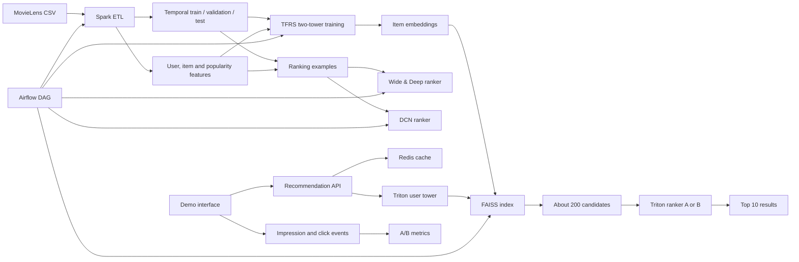

# Project Plan: Large-Scale Personalized Recommendation Engine

## 1. Project brief

| Field | Value |
|---|---|
| Specialization | AI / Machine Learning |
| Dataset | MovieLens 25M |
| Batch start | 19 October 2026 |
| Deadline | 20 November 2026 |
| Estimated implementation effort | 14 focused days |
| Main objective | Build and demonstrate a production-style two-stage recommender |

The system will first retrieve a few hundred plausible movies quickly, then use
a more expressive model to rank those candidates precisely. The project covers
the data, modeling, evaluation, serving, orchestration, caching, and experiment
tracking needed to explain how a real recommendation service works.

## 2. Why MovieLens 25M

MovieLens 25M is the best fit for the project timeline because it provides:

- 25,000,095 timestamped ratings;
- 162,541 anonymized users;
- 62,423 movies;
- movie titles and genres;
- 1,093,360 user-applied tags; and
- enough volume to justify Spark and nearest-neighbor indexing while remaining
  practical on one development machine.

The dataset contains ratings rather than impressions and clicks. Ratings can be
converted into implicit relevance labels for model training, but online CTR must
come from the demo's own event log or be clearly described as simulated.

## 3. Scope and success criteria

### Required scope

- Clean MovieLens data and split it by time using Spark.
- Build user history, item popularity, genre, and activity features.
- Train a TensorFlow Recommenders two-tower retrieval model.
- Export item embeddings and index them with FAISS.
- Train two deep ranking variants: Wide & Deep and DCN.
- Support unknown users with popularity and content-based fallbacks.
- Cache recommendation results in Redis.
- Serve TensorFlow models through Triton.
- Schedule the training/indexing workflow with Airflow.
- Run an A/B demonstration and report NDCG, Recall@K, latency, and CTR.

### Definition of done

The project is complete when a reviewer can:

1. clone the repository and follow the setup instructions;
2. run the data pipeline on a small sample;
3. reproduce the reported offline metrics;
4. request recommendations for known and unknown users;
5. observe retrieval, ranking, caching, and A/B assignment in the demo;
6. inspect a successful Airflow DAG run;
7. see automated tests pass; and
8. understand the design and results from the README and presentation.

## 4. Architecture



### Online request path

1. Receive a user ID and optional recent interactions or genre preferences.
2. Assign the user deterministically to ranking model A or B.
3. Check Redis for a fresh cached result.
4. For a known user, obtain a user embedding from the user tower.
5. Search FAISS for approximately 200 candidate movie IDs.
6. Join the candidate IDs with ranking features.
7. Ask Triton to score candidates with the assigned ranking model.
8. Filter already-seen movies and return the top 10.
9. Cache the response and record an impression event.

For an unknown user, the service skips the learned user-ID path and invokes the
cold-start strategy described below.

## 5. Data design

### Inputs

The initial implementation uses:

- `ratings.csv`: `userId`, `movieId`, `rating`, `timestamp`;
- `movies.csv`: `movieId`, `title`, `genres`; and
- optionally `tags.csv` for content-based fallback features.

### Temporal split

Interactions must never be randomly split. The initial experiment will use
global timestamp cutoffs calculated from the ordered interaction data:

- earliest 80%: training;
- next 10%: validation; and
- latest 10%: test.

Exact cutoff timestamps will be stored in a versioned configuration file. All
feature statistics and vocabularies must be fitted on the training period only.
Validation and test transformations reuse those fitted artifacts.

The global split best represents a real deployment that trains on the past and
predicts the future. We will also report how many validation/test users and
items are unseen during training, because those are genuine cold-start cases.

### Cleaning checks

- Enforce the declared schema instead of relying on CSV inference.
- Remove exact duplicate interactions if any exist.
- Validate rating range and non-null identifiers.
- Parse timestamps into UTC datetimes.
- Extract release year carefully from titles when present.
- Convert the pipe-delimited genre field into an array.
- Keep raw inputs immutable.
- Write cleaned tables and features as Parquet.

### Training labels

MovieLens does not contain impressions. For the initial implicit-ranking task:

- ratings of 4.0 or higher are positive preference events;
- sampled unobserved movies are training negatives; and
- rating value can optionally be used as an example weight.

Unobserved does not necessarily mean disliked, so negative sampling assumptions
must be documented. A second experiment may train a rating-regression objective
and compare its ranking quality.

## 6. Feature plan

### User features

- User ID embedding
- Number of historical interactions
- Mean and standard deviation of ratings
- Recent activity count
- Days since last interaction at the feature cutoff
- Historical genre preference vector
- Recent-genre preference vector

### Item features

- Movie ID embedding
- Tokenized movie title
- Multi-hot or embedded genres
- Release year or age bucket
- Training-period rating count
- Training-period mean rating
- Recency-adjusted popularity

### Pair/context features for ranking

- Two-tower dot-product score
- User/movie embedding interaction
- User-to-movie genre affinity
- Movie popularity bucket
- User activity bucket
- Difference between user mean rating and movie mean rating
- Movie age
- Rank or score produced by retrieval

Every time-dependent feature must be computed using information available before
the prediction cutoff.

## 7. Stage one: retrieval

The retrieval model contains two neural networks with a shared embedding space.

### User tower

The user tower combines user ID, activity statistics, and genre-history features
to produce a 64- or 128-dimensional user vector.

### Item tower

The item tower combines movie ID, title, genres, year, and popularity features
to produce an item vector of the same dimension.

### Objective and evaluation

TensorFlow Recommenders retrieval loss will make observed user/movie pairs more
similar than in-batch negatives. Evaluation will report Recall@50, Recall@100,
and Recall@200 against held-out future positives.

### FAISS index

The item embeddings will be converted to contiguous `float32` arrays. We will
start with exact inner-product search as the correctness reference, then compare
it with an approximate index such as HNSW or IVF. The comparison will report:

- index build time;
- index size;
- P50 and P95 search latency; and
- approximate recall relative to exact search.

With only about 62,000 movies, exact search may already be fast. The approximate
benchmark is still valuable because it demonstrates the scaling trade-off
without pretending the dataset is larger than it is.

## 8. Stage two: ranking

The ranker receives only the retrieved candidates, so it can use more features
and computation per candidate.

### Variant A: Wide & Deep

The wide component memorizes useful sparse crosses while the deep component
learns general patterns from embeddings and numerical features.

### Variant B: Deep & Cross Network

DCN explicitly learns feature interactions such as user genre preference crossed
with movie genre or user activity crossed with item popularity.

### Ranking metrics

- NDCG@10 as the primary ordering-quality metric
- Recall@10 and Recall@20
- optional Mean Reciprocal Rank
- comparison with popularity-only and retrieval-score-only baselines

The retrieval ceiling must also be reported: a ranker cannot place a relevant
movie in the top 10 if retrieval failed to include it in the candidate set.

## 9. Cold-start strategy

### Unknown user with no preferences

Return a cached, recency-adjusted popularity list with optional diversity rules
to avoid filling all positions with one genre.

### Unknown user with selected genres

Return popular, highly rated movies from the selected genres. Genre preference
weights can be used to diversify the result.

### Unknown user with a few liked movies

Build a temporary content profile from the liked movies' genres and tags, then
retrieve content-similar movies. This avoids relying on an unseen user-ID
embedding.

### Cache behavior

Redis will store:

- known-user recommendation lists with a TTL;
- global and per-genre popularity lists;
- lightweight user/session preferences; and
- A/B impression and click events, likely through Redis Streams.

Cache keys must include the model version so a newly deployed model never reads
stale results produced by an older version.

## 10. Serving design

The serving API owns orchestration; Triton owns neural-network inference.

- Triton user-tower model: user features to user embedding
- Local/service FAISS index: user embedding to candidate IDs and scores
- Triton ranking models: candidate feature batch to relevance scores
- Redis: result cache, popularity fallback, and experiment events
- API: validation, filtering, A/B assignment, orchestration, and response schema

The API should expose at least:

- `GET /health`
- `GET /recommendations/{user_id}`
- `POST /recommendations/cold-start`
- `POST /events/impression`
- `POST /events/click`
- `GET /experiments/{experiment_id}/metrics`

The exact request/response contracts will be documented before implementation.

## 11. Airflow pipeline

The retraining DAG will contain small, observable tasks:

1. verify or ingest raw data;
2. clean and create temporal splits;
3. build training-period features;
4. train the retrieval model;
5. evaluate retrieval quality;
6. export item embeddings and build the FAISS index;
7. build ranking examples;
8. train both ranking models;
9. evaluate end-to-end recommendation quality;
10. export Triton model versions; and
11. publish a model only if quality checks pass.

For the internship demo, Airflow can run locally. The documentation must state
that local/standalone deployment is not a production architecture.

## 12. A/B experiment

Users will be assigned deterministically so they remain in one variant:

```text
hash(experiment_id + user_id) modulo 2
    0 -> Variant A: Wide & Deep
    1 -> Variant B: DCN
```

Each impression event records experiment ID, variant, user/session, recommended
movie IDs, ranks, model version, and timestamp. Each click references its
impression and selected rank.

The demo dashboard will report impressions, clicks, CTR, and position-aware CTR
for each variant. If traffic is generated by replay or simulation, the result
will be labeled as simulated rather than presented as real user behavior.

## 13. Evaluation and performance report

The final report should contain one comparison table similar to:

| System | Recall@10 | NDCG@10 | Recall@200 | P95 latency |
|---|---:|---:|---:|---:|
| Popularity baseline | TBD | TBD | N/A | TBD |
| Retrieval score only | TBD | TBD | TBD | TBD |
| Retrieval + Wide & Deep | TBD | TBD | TBD | TBD |
| Retrieval + DCN | TBD | TBD | TBD | TBD |

Operational measurements should include:

- Spark processing time and row counts;
- training time and best validation epoch;
- FAISS build/search measurements;
- API P50/P95 latency and throughput;
- Redis cache hit rate; and
- test count and pass/fail result.

## 14. Testing strategy

### Unit tests

- schemas and data validation;
- temporal split boundaries;
- no future information in feature windows;
- metric calculations;
- FAISS ID mapping;
- deterministic A/B assignment;
- cache-key versioning; and
- cold-start selection and filtering.

### Integration tests

- tiny Spark input through processed Parquet output;
- trained toy towers through FAISS retrieval;
- API request through Redis and mocked/real Triton;
- known-user and unknown-user recommendation flows; and
- one small end-to-end Airflow DAG run.

### Performance checks

- batch retrieval latency;
- end-to-end API latency;
- cache-hit versus cache-miss latency; and
- a short concurrent load test.

## 15. Fourteen-day implementation schedule

| Day | Focus | Verifiable output |
|---:|---|---|
| 1 | Environment, data contract, baseline | Reproducible setup and popularity metrics |
| 2 | Spark cleaning and temporal split | Parquet splits plus leakage tests |
| 3 | Spark features | Versioned user/item feature tables |
| 4 | Two-tower prototype | Model trains on a small sample |
| 5 | Full retrieval experiment | Recall@K results and exported towers |
| 6 | FAISS | Saved index and accuracy/latency benchmark |
| 7 | Ranking dataset | Reproducible positive/negative examples |
| 8 | Two rankers | Wide & Deep and DCN checkpoints |
| 9 | End-to-end evaluation | Baseline/model comparison table |
| 10 | API, Redis, cold start | Known/cold recommendation endpoints |
| 11 | Triton | Models served from a versioned repository |
| 12 | Airflow | Successful local retraining DAG run |
| 13 | Demo and A/B events | UI, experiment metrics, integration/load tests |
| 14 | Final communication | README, diagrams, video, slides, reflection |

## 16. Deliverables plan

### Working demo

The demo should show a known user, an unknown user, retrieved candidates, final
recommendations, cache status, assigned model variant, and experiment metrics.

### GitHub repository

- Small commits organized by milestone
- No dataset, secrets, caches, or model binaries in Git
- Setup instructions tested from a clean environment
- Commands for sample and full-data runs
- Reproducible seeds and versioned configuration

### Documentation

- Architecture diagram
- Dataset and feature definitions
- API request/response documentation
- Model cards or concise model descriptions
- Evaluation methodology and limitations

### Ten-minute presentation outline

1. Problem and business motivation — 1 minute
2. Dataset and temporal split — 1 minute
3. Architecture — 2 minutes
4. Retrieval and ranking models — 2 minutes
5. Demo — 2 minutes
6. Results, challenges, and limitations — 1.5 minutes
7. Next steps and personal learning — 0.5 minute

### Individual reflection prompts

- What did I personally design and implement?
- What was the hardest technical problem?
- What failed, and how did I debug it?
- What did the baselines teach me?
- What would I change for a real production deployment?
- Which recommendation-system concepts can I now explain confidently?

## 17. Learning workflow

For each milestone:

1. explain the concept in plain language;
2. implement the smallest useful version;
3. run it on tiny deterministic data;
4. inspect outputs rather than trusting that it ran;
5. add tests for the assumptions;
6. scale it to the sample and then the full dataset;
7. record results and limitations; and
8. make a focused Git commit.

This keeps the project educational and makes every repository commit something
that can be discussed confidently in the final presentation or an interview.

At the end of every implementation day, create a report using
[`DAY_REPORT_TEMPLATE.md`](DAY_REPORT_TEMPLATE.md). The report must include a
code walkthrough, every observed failure and its fix, ordered learning
resources, and practice exercises in addition to engineering results.

## 18. Environment decision

The development host has 16 CPU cores and approximately 31 GiB RAM, but no
working NVIDIA GPU. That is sufficient for Spark local mode, CPU TensorFlow, and
CPU FAISS. Development should begin on a small subset before full-data runs.

The host Python is 3.14, outside TensorFlow's currently documented Python
3.9–3.12 binary support range. The project will therefore use Python 3.11 in an
isolated environment/container. The system Python will not be modified.

## 19. Risks and controls

| Risk | Control |
|---|---|
| Dependency conflicts | Pin and test one Python/TensorFlow/Triton combination |
| Slow iteration on 25M rows | Use a deterministic sample before full runs |
| Temporal leakage | Centralize cutoffs and test feature timestamps |
| Weak neural-model results | Keep popularity and retrieval-score baselines |
| False sampled negatives | Document the assumption and test sampling strategies |
| No genuine online users | Label replay/simulated CTR honestly |
| Too much infrastructure work | Implement one local, demonstrable path per tool |
| Large artifacts in Git | Ignore data/models and document regeneration commands |

## 20. References

- [MovieLens 25M dataset](https://grouplens.org/datasets/movielens/25m/)
- [MovieLens 25M README](https://files.grouplens.org/datasets/movielens/ml-25m-README.html)
- [TensorFlow Recommenders](https://www.tensorflow.org/recommenders)
- [TensorFlow Recommenders retrieval tutorial](https://www.tensorflow.org/recommenders/examples/basic_retrieval)
- [TensorFlow Recommenders DCN tutorial](https://www.tensorflow.org/recommenders/examples/dcn)
- [TensorFlow installation guide](https://www.tensorflow.org/install/pip)
- [FAISS documentation](https://github.com/facebookresearch/faiss/wiki)
- [Triton Inference Server documentation](https://docs.nvidia.com/deeplearning/triton-inference-server/)
- [Apache Spark documentation](https://spark.apache.org/docs/latest/)
- [Apache Airflow documentation](https://airflow.apache.org/docs/)
- [Redis documentation](https://redis.io/docs/latest/)
